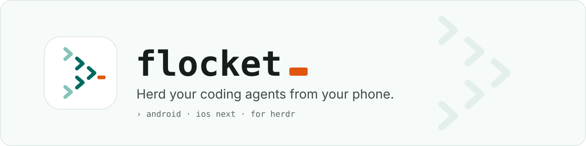
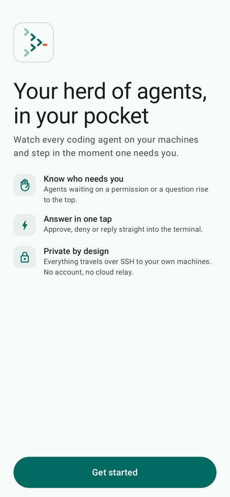
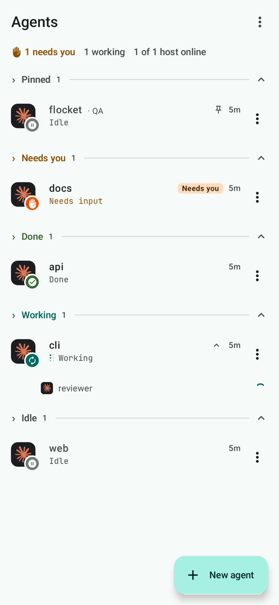
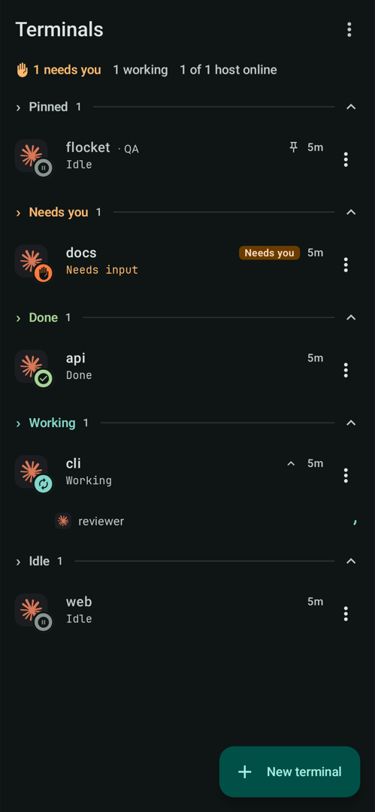
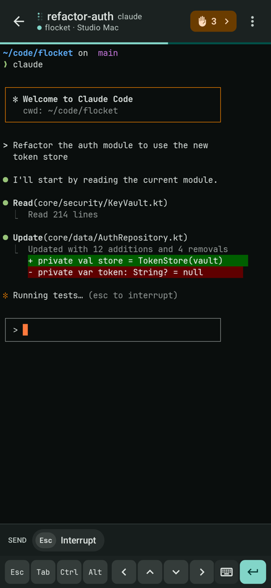
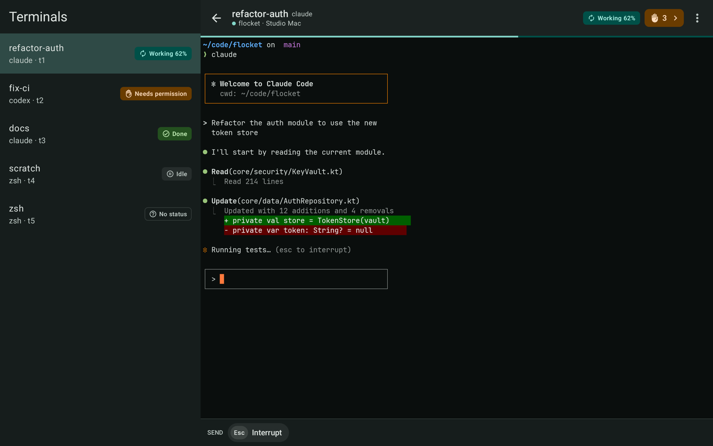
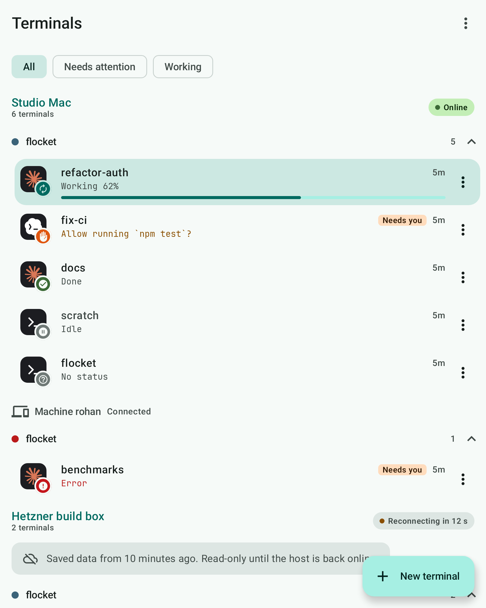
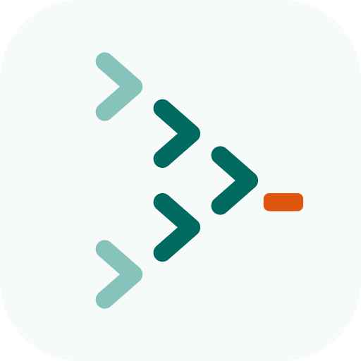

<p align="center">
  <picture>
    <source media="(prefers-color-scheme: dark)" srcset="docs/readme/banner-dark.svg">
    
  </picture>
</p>

<p align="center">
  
  <a href="https://github.com/herdrdev/herdr"></a>
  <a href="LICENSE"></a>
</p>

<p align="center"><b>Check on, answer and steer the coding agents running in Herdr on your machine, without walking back to the desk.</b></p>

Your agents keep working while you're away from the keyboard. Sooner or later one of them
stops to ask a question, finishes, or gets stuck. Flocket puts every one of them in your
pocket: it shows which terminal needs you, opens it as a real terminal, lets you type the
answer, and gets out of the way. Nothing runs on the phone. The agents stay on your machine,
inside [herdr-core](https://github.com/herdrdev/herdr-core), and Flocket is a native window
onto them. It's built for phones, foldables and tablets alike.

<p align="center">
  
  
  
  
</p>
<p align="center">
  
  
</p>

<picture>
  <source media="(prefers-color-scheme: dark)" srcset="docs/readme/divider-dark.svg">
  
</picture>

##  Why Flocket

- **Native, not a web view.** Kotlin and Jetpack Compose on Android. A Swift and SwiftUI app
  for iOS comes next.
- **Direct and private.** The phone talks to your machine over SSH (`ssh host hc connect`):
  no relay, no cloud account, no gateway. The host key is verified before any credential is
  sent, and device keys are sealed by the Android Keystore.
- **Real terminals.** Rendering is powered by
  [libghostty](https://github.com/ghostty-org/ghostty), with flow control, so a busy agent
  never freezes the app. IME, hardware keyboard, an extra-keys row, pinch zoom, scrollback and
  copy/paste all work.
- **Every machine at once.** Add several hosts, plus herdr-core's federated machines
  (`rohan/t7`). Each one connects, fails and reconnects on its own, and stale data is labelled.
- **Built for every screen.** Phones get a list, then a full-screen terminal. Tablets and
  unfolded foldables show the list and the terminal side by side, with a hideable sidebar.
- **Safe by design.** Closing the app never stops an agent: the core owns the runtime. Input
  is sent at most once and never replayed after a dropped connection. A "maybe sent" outcome
  is shown as unknown, not hidden.

##  Get started

You need:

- A machine running [herdr-core](https://github.com/herdrdev/herdr-core) 0.1.16 or newer,
  reachable over SSH from your phone. Flocket finds `hc` on the host by itself.
- An Android 10 or newer phone, foldable or tablet.

Signed APKs are attached to [GitHub Releases](https://github.com/tajchert/flocket/releases).
To build from source, see [android/README.md](android/README.md). On first run the app
creates a device key, shows the `authorized_keys` line to add on your machine, and asks you to
trust the host key.

> Status: early development. Android comes first, then iOS. Flocket is an independent
> project and is not affiliated with Herdr.

<picture>
  <source media="(prefers-color-scheme: dark)" srcset="docs/readme/divider-dark.svg">
  
</picture>

##  Tech stack

Android versions come from [`android/gradle/libs.versions.toml`](android/gradle/libs.versions.toml).

| Area | Choice |
|---|---|
| Language | Kotlin 2.4.21, coroutines 1.11.0, JDK 21 toolchain |
| UI | Jetpack Compose (BOM 2026.09.00), Material 3, Material 3 Adaptive 1.3.0 |
| Navigation | Navigation 3 1.2.0, list-detail scenes |
| Terminal | libghostty-vt (Ghostty's VT core) through a small JNI shim ([ADR-0003](docs/decisions/0003-terminal-engine-libghostty.md)) |
| SSH | SSHJ 0.41.2 with Bouncy Castle 1.84 ([ADR-0005](docs/decisions/0005-direct-ssh-transport.md)) |
| DI | Hilt 2.60.1 |
| Storage | Room 3.0.3 (hosts, pinned host keys), DataStore 1.3.0 (preferences) |
| Serialization | kotlinx.serialization 1.12.0 |
| Testing | JUnit 4, Turbine, Robolectric 4.17, Compose Preview Screenshot Testing, Apache MINA sshd, Kover |
| Build | AGP 9.5.0, convention plugins in `build-logic`, Spotless with ktlint |
| Platform | minSdk 29, targetSdk and compileSdk 37 |

##  Architecture

Each platform is native, and the platforms share the protocol: `protocol/` holds the
herdr-core wire spec, `hc schema` snapshots and wire fixtures that every client tests
against ([ADR-0004](docs/decisions/0004-native-per-platform-shared-fixtures.md)).

The Android app is a multi-module Gradle project:

```
app                     navigation, DI graph, lifecycle
 └ feature:*:impl       screens, view models
    ├ feature:*:api     navigation keys, public contracts
    └ core:ui · core:terminal · core:data
       core:data      ─▶ session · ssh · database · datastore · security
       session · ssh  ─▶ protocol ─▶ model · common          (pure Kotlin/JVM)
```

- **Boundaries are enforced by the build.** A feature never depends on another feature's
  `impl`, `core` never depends on a feature, and the pure JVM modules never touch Android.
- **Errors are values.** Public APIs of the session, data and repository layers return
  `AppResult<T>` (`Success` or `Failure(AppError)`) over a small sealed error taxonomy, and
  never throw.
- **One model per connection.** `CoreSession` owns hello, subscriptions and terminal
  records, and UI state is derived from it. Every reconnect starts a new epoch, and callbacks
  from older epochs are dropped.
- **The protocol is transport-agnostic.** `core:protocol` only sees a `ByteTransport`, so
  SSH, a local process and an in-memory fake core are interchangeable.
- **Screens don't branch on size.** Destinations declare a list or detail pane role, and a
  Navigation 3 scene strategy decides what fits the window.

More: [Android architecture](android/docs/ARCHITECTURE.md),
[Adaptive layouts](android/docs/ADAPTIVE_LAYOUTS.md),
[Terminal rendering](android/docs/TERMINAL_RENDERING.md),
[Security defaults](android/docs/SECURITY_DEFAULTS.md).

##  Rules every change keeps

These hold on every platform. The full wording is in [AGENTS.md](AGENTS.md).

1. **Only herdr-core.** Negotiate `hello`: refuse an incompatible generation, accept
   additive versions and unknown fields, never pin an exact version.
2. **The core owns runtime.** Closing or detaching the app never stops a terminal or agent.
3. **Mutations are at most once.** Input, keys, run, kill and approvals are never replayed
   after a drop. The outcome is shown as unknown and the state is re-read.
4. **Status is not liveness.** Agent status may be unknown, and process state is separate.
5. **Addresses are opaque and federated.** `t7` and `rohan/t7` are different terminals.
6. **Trust before credentials.** The SSH host key is verified first, and a changed key is a
   hard stop.
7. **Hosts are independent.** One failing host never blocks another. Stale data is labelled,
   and writes are disabled while it is stale.

Binding decisions are recorded as ADRs in [`docs/decisions/`](docs/decisions/): app
identity, license, terminal engine, native code with shared fixtures, direct SSH transport,
the background keep-alive service, fitting a terminal on open, renaming in the desktop layout,
and device journeys.

##  Repository map

| Path | Contents |
|---|---|
| [`android/`](android/) | Android app: [README](android/README.md) · [agent guide](android/AGENTS.md) |
| [`protocol/`](protocol/) | herdr-core [protocol spec](protocol/SPEC.md), schema snapshots and wire fixtures shared by every platform |
| [`docs/decisions/`](docs/decisions/) | Architecture Decision Records |
| [`docs/ROADMAP.md`](docs/ROADMAP.md) | Next milestones, with the code areas to start from |
| [`docs/design/`](docs/design/) | Milestone design documents |
| [`docs/reference/`](docs/reference/) | Background research on herdr-core |
| [`docs/readme/`](docs/readme/) | README art and screenshots |
| `ios/` | Future iOS app |

##  Testing

Tests run in layers: JVM unit tests, contract tests against the shared wire fixtures,
integration tests against a real `hc` and an embedded SSH server, Robolectric Compose tests,
screenshot tests at phone, foldable and tablet sizes, and device journeys that drive the real
app over SSH against a real `hc`
([ADR-0009](docs/decisions/0009-device-journeys-androidtest.md)). Tests that use `hc` run in
an isolated session and never touch your own.

The commands live in one place: [android/docs/TESTING.md](android/docs/TESTING.md).

##  Roadmap

Next up: validation on physical devices, notifications when an agent needs you, sending files
to the host, an agent-first view, previews, reaching hosts beyond the local network, and the
iOS app. Scope, open decisions and where to start are in [docs/ROADMAP.md](docs/ROADMAP.md).

##  Contributing

Start with [AGENTS.md](AGENTS.md). It sets the shared rules for humans and AI agents alike,
then points to the platform guide. A protocol change starts in `protocol/`, an
architecture-wide change needs an ADR, and commits follow
[Conventional Commits](https://www.conventionalcommits.org/).

##  License

[Apache-2.0](LICENSE). Third-party notices are in [NOTICE](NOTICE) and in each platform's
`THIRD_PARTY_NOTICES.md`.

<picture>
  <source media="(prefers-color-scheme: dark)" srcset="docs/readme/divider-dark.svg">
  
</picture>

<p align="center">
  <picture>
    <source media="(prefers-color-scheme: dark)" srcset="docs/readme/icon-dark.svg">
    
  </picture>
  <br>
  <code>› made for the herd</code>
</p>
