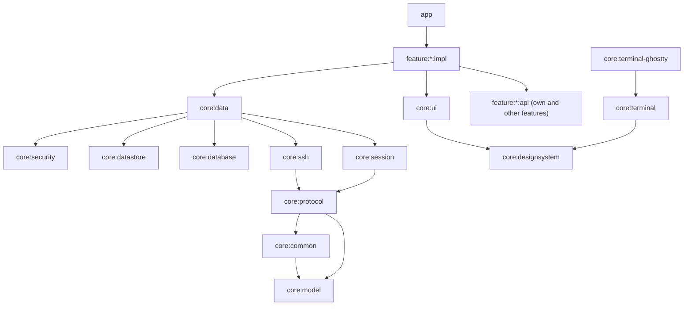

# Android architecture

Condensed from the [foundation design](../../docs/design/2026-11-01-android-foundation.md) (section 4), which is authoritative.

## Module graph

Layers, top to bottom: `:app` (navigation, DI graph, lifecycle); feature modules; Android core modules (`ui`, `designsystem`, `terminal`, `data`, `database`, `datastore`, `security`, `terminal-ghostty`); pure Kotlin/JVM modules (`session`, `ssh`, `protocol`, `model`, `common`).

## Layer rules

1. **Dependency direction**: features depend on core. Core never depends on a feature. A feature may depend on another feature's `api`, never its `impl`. JVM modules never depend on Android modules. The build enforces the feature/core rules (`ModuleBoundaryConventionPlugin`).
2. **Protocol is transport-agnostic.** `core:protocol` sees only `ByteTransport`. SSH, a local process and the in-memory fake core implement it.
3. **One authoritative model per connection.** `CoreSession` owns hello, subscription and terminal records; UI state is derived from it. Each (re)connect starts a new connection epoch and callbacks from older epochs are dropped.
4. **Hosts are independent.** One host reconnecting never blocks another. Cached data from a disconnected host is shown as stale and writes are disabled.
5. **Status is not liveness.** Process state and agent status (possibly unknown) are separate fields.
6. **Mutations are at most once.** Reads may retry; writes are never replayed automatically. After a drop, `ActionOutcome.Unknown` is shown and state is reconciled by re-reading.

## Error handling

Public APIs of `core:session`, `core:data` and repositories return `AppResult<T>` (`Success` or `Failure(AppError)`) and do not throw; `CancellationException` is always rethrown. `AppError` is a small sealed taxonomy in `core:common` (`Unreachable`, `AuthFailed`, `HostKeyUnknown`, `HostKeyChanged`, `CoreNotFound`, `CoreIncompatible`, `Rpc(code)`, `Timeout`, `OutcomeUnknown`, `Protocol`, `Storage`); a new case needs review. `core:ui` maps each error to a string resource and a suggested action. Low-level modules convert their typed exceptions to `AppError` at their public boundary only.

## Build logic

`build-logic/convention` holds the convention plugins (`flocket.jvm.library`, `flocket.android.library`, `flocket.android.compose`, `flocket.android.feature`, `flocket.android.application`, `flocket.android.room`, `flocket.hilt`). Module build files only pick plugins and declare project-specific dependencies. Spotless with ktlint and Compose rules is configured in the root `build.gradle.kts`; style options are in `.editorconfig`.
