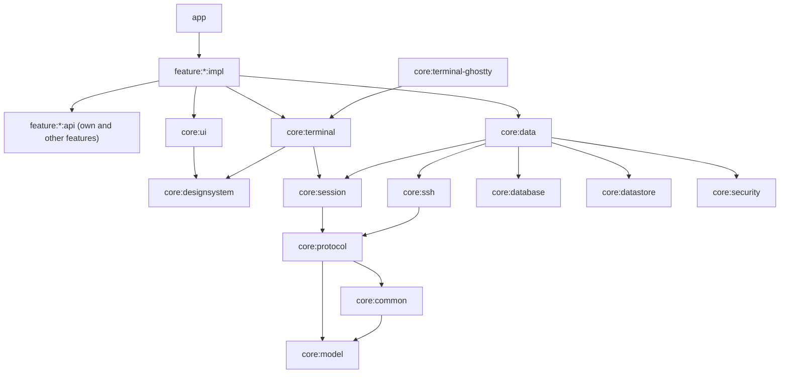

# Android architecture

Condensed from the [foundation design](../../docs/design/2026-11-01-android-foundation.md) (section 4), which is authoritative.

## Module graph

Layers, top to bottom: `:app` (navigation, DI graph, lifecycle); feature modules; Android core modules (`ui`, `designsystem`, `terminal`, `data`, `database`, `datastore`, `security`, `terminal-ghostty`); pure Kotlin/JVM modules (`session`, `ssh`, `protocol`, `model`, `common`).

## Layer rules

1. **Dependency direction**: features depend on core. Core never depends on a feature. A feature may depend on another feature's `api`, never its `impl`. JVM modules never depend on Android modules. The build enforces the feature/core rules (`ModuleBoundaryConventionPlugin`).
2. **Protocol is transport-agnostic.** `core:protocol` sees only `ByteTransport`. SSH, a local process and the in-memory fake core implement it.
3. **One authoritative model per connection.** `CoreSession` owns hello, subscription and terminal records; UI state is derived from it. Each (re)connect starts a new connection epoch and callbacks from older epochs are dropped.
4. **Hosts are independent.** One host reconnecting never blocks another. Cached data from a disconnected host is shown as stale and writes are disabled.
5. **Status is not liveness.** Process state and agent status (possibly unknown) are separate fields.
6. **Mutations are at most once.** Reads may retry; writes are never replayed automatically. After a drop, `ActionOutcome.Unknown` is shown and state is reconciled by re-reading.

## Desktop layout and workspace grouping

`SessionState.desktopLayout` is the desktop app's `herdr-app` document for the endpoint's own machine (protocol/SPEC.md §9.1), parsed by `HerdrAppLayoutParser` in `core:session`. Flocket reads it, and its only write is renaming one space or tab: `CoreSession.renameInLayout(LayoutRef, name)` changes that `name` with a compare-and-set `doc.set` (with `on` for a federated machine) and lets the `doc` event refetch show the result ([ADR-0008](../../docs/decisions/0008-rename-in-desktop-layout.md)). The session re-reads it after every subscribe and resubscribe, after `missed`, and on its `doc` events. A failed read or a disconnect keeps the last value, so cached data is shown as stale like the rest of the state. `buildWorkspace(terminals, layout, machineLayouts)` in `core:model` turns one host's state into spaces, then tabs, then panes. Each terminal is placed by the first source that knows it: the desktop layout (document order), then the `herdr.space`/`herdr.tab` labels (first appearance in core order), then the terminal's start folder (joining a desktop or label space with the same folder, else a folder space). Federated terminals follow the same rules per machine, using that machine's layout (`SessionState.machineLayouts`), after all local spaces. Unnamed spaces and tabs have blank names and a 1-based `number`; the UI shows "Space N" / "Tab N" from string resources. A space's or tab's status is the most urgent status among its terminals that have not finished.

`SessionState.machineLayouts` holds each federated machine's own `herdr-app` document, keyed by machine name and read with `doc.get {on}`. Each connected machine is read on the same triggers (plus its own `doc` events and its return, which sends `missed`), independently of the local document and of other machines, with one read in flight per machine. A failed read or a machine that is not connected keeps its last layout, and a machine that leaves `machine.list` (removed or renamed) loses its entry. `machine.list` is re-read on `missed` and, because rename and rm send no `missed`, when a terminal of an unlisted machine appears or a listed machine's last terminal goes (one re-read in flight per link).

## Error handling

Public APIs of `core:session`, `core:data` and repositories return `AppResult<T>` (`Success` or `Failure(AppError)`) and do not throw; `CancellationException` is always rethrown. `AppError` is a small sealed taxonomy in `core:common` (`Unreachable`, `AuthFailed`, `HostKeyUnknown`, `HostKeyChanged`, `CoreNotFound`, `CoreIncompatible`, `Rpc(code)`, `Timeout`, `OutcomeUnknown`, `Protocol`, `Storage`); a new case needs review. `core:ui` maps each error to a string resource and a suggested action. Low-level modules convert their typed exceptions to `AppError` at their public boundary only.

## Navigation

One Navigation 3 back stack, owned by `:app` (`FlocketNavHost`). Features never know each other's `impl`.

- `feature:x:api` exposes `@Serializable` `NavKey` routes (e.g. `HostsRoute`, `HostDetailRoute(hostId)`, `OnboardingRoute`). Other features navigate by pushing those keys.
- `feature:x:impl` contributes its entries with a Hilt multibinding: a `@Module @InstallIn(SingletonComponent)` whose `@Provides @IntoSet` returns an `EntryProviderInstaller` (defined in `:core:ui`). The installer registers `entry<Route> { ... }` and receives a `Navigator` (`navigate`, `back`, `goHome`) instead of the back stack. List/detail roles go in entry metadata (`ListDetailSceneStrategy.listPane()` / `detailPane()`).
- `:app` injects `Set<EntryProviderInstaller>`, installs them into one `entryProvider`, and adds the placeholder entries for Terminals and Settings until those features land (their routes then move to the respective `:api`).
- Top-level destinations (Terminals = start, Hosts, Settings) are shown by `NavigationSuiteScaffold`: bottom bar on compact windows, rail on medium and expanded. Selecting one replaces the stack; the first stack element is the selected tab. The bar is hidden on full-screen routes (`isFullScreen()` in `:app`: onboarding, host edit).
- First run: `AppViewModel` reads `UserPreferences.onboardingCompleted` once; if false the stack starts at `OnboardingRoute`, which calls `goHome()` when done.
- One-off results (saved, deleted, finished) are state flags in the UiState; the route reacts in a `LaunchedEffect` and navigates.

## Build logic

`build-logic/convention` holds the convention plugins (`flocket.jvm.library`, `flocket.android.library`, `flocket.android.compose`, `flocket.android.feature`, `flocket.android.application`, `flocket.android.room`, `flocket.hilt`). Module build files only pick plugins and declare project-specific dependencies. Spotless with ktlint and Compose rules is configured in the root `build.gradle.kts`; style options are in `.editorconfig`.
